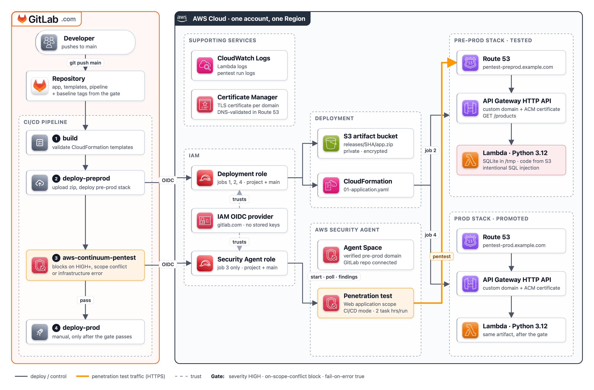
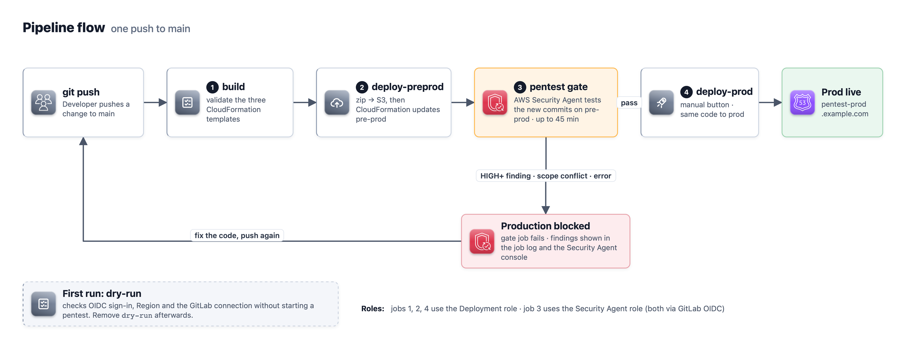

# AWS Security Agent + GitLab CI/CD POC

A minimal proof-of-concept showing:

**Git push → deploy to pre-prod → AWS Security Agent penetration test → gate → manual production promotion**

The sample application has a deliberate SQL injection vulnerability. The first pipeline run should get a `HIGH` finding and block production. After you fix the query, the next run passes.

> **Safety:** Deploy this only to an isolated AWS account. Do not connect it to production data. The vulnerability is intentional.

## Table of contents

- [Architecture](#architecture)
  - [Components](#components)
  - [Pipeline flow](#pipeline-flow)
- [Repository](#repository)
- [Before you start](#before-you-start)
- [Step 1: Set your values](#step-1-set-your-values)
- [Step 2: Create the GitLab OIDC provider](#step-2-create-the-gitlab-oidc-provider)
- [Step 3: Create the artifact bucket](#step-3-create-the-artifact-bucket)
- [Step 4: Create the GitLab IAM roles](#step-4-create-the-gitlab-iam-roles)
- [Step 5: Deploy pre-prod and test it](#step-5-deploy-pre-prod-and-test-it)
- [Step 6: Set up AWS Security Agent](#step-6-set-up-aws-security-agent)
- [Step 7: Configure GitLab](#step-7-configure-gitlab)
- [Step 8: Run the pipeline](#step-8-run-the-pipeline)
- [Clean up](#clean-up)
- [Security notes](#security-notes)
- [References](#references)

## Architecture

### Components



| Component | Created by | Purpose |
|---|---|---|
| GitLab pipeline | `.gitlab-ci.yml` | Validates, deploys pre-prod, runs the pentest gate, then offers a manual prod deploy |
| IAM OIDC provider | Step 2 (CLI) | Lets GitLab jobs get short-lived AWS credentials, so no access keys are stored |
| Deployment role | `02-gitlab-security-agent-iam.yaml` | Used by `build`, `deploy-preprod` and `deploy-prod` to upload the zip and deploy stacks |
| Security Agent role | `02-gitlab-security-agent-iam.yaml` | Used only by the gate job; it can start, poll and stop a pentest and read its findings |
| S3 artifact bucket | `00-artifact-bucket.yaml` | Stores one private, versioned zip per commit for Lambda |
| Pre-prod / prod stacks | `01-application.yaml` | Route 53 name → ACM certificate + API Gateway custom domain → HTTP API → Lambda |
| Lambda app | `app/index.py` | `GET /products?category=...`, backed by SQLite in `/tmp`, vulnerable to SQL injection on purpose |
| AWS Security Agent | Step 6 (console) | Verifies the pre-prod domain, runs the scoped pentest, and returns findings to the gate |
| Baseline tags | Security Agent gate | `continuum/pentest/cicd/baseline/*` tags record the last commit that passed, so the next run tests only newer commits |

### Pipeline flow



Key points:

- The pentest runs **in AWS**, not on the GitLab runner. The gate job only starts it, waits, and reads the result.
- It tests the **deployed pre-prod app** after each deploy. It is not a pull-request code scan.
- Production is never tested or exposed to the pentest; it only receives code that passed the gate.

## Repository

```text
aws-security-agent-poc/
├── .gitlab-ci.yml                         # pipeline
├── app/index.py                           # vulnerable Lambda (GET /products)
├── cloudformation/
│   ├── 00-artifact-bucket.yaml            # S3 bucket for Lambda zips
│   ├── 01-application.yaml                # Lambda, API Gateway, ACM, Route 53
│   └── 02-gitlab-security-agent-iam.yaml  # GitLab OIDC roles
└── scripts/
    ├── package.sh                         # zip the app
    ├── deploy-application.sh              # upload + deploy a stack
    └── destroy.sh                         # delete the app stacks
```

## Before you start

You need:

- An isolated AWS account, and the AWS CLI logged in to it with admin rights (for the one-time setup).
- A Route 53 public hosted zone in that account, for example `example.com`.
- A GitLab.com project containing this repository, with `main` as the default branch.
- An AWS Region where AWS Security Agent is available.

## Step 1: Set your values

Run all commands from the repository root. Set these once in your terminal; every later command uses them. If you open a new terminal, run this block again.

```bash
export AWS_REGION=us-east-1                            # Region for everything, including AWS Security Agent
export HOSTED_ZONE_ID=Z0123456789ABCDEFGHIJ            # Route 53 hosted zone ID
export PREPROD_DOMAIN=pentest-preprod.example.com      # hostname for the pre-prod app
export GITLAB_PROJECT=my-group/aws-security-agent-poc  # exact GitLab project path
export ACCOUNT_ID=$(aws sts get-caller-identity --query Account --output text)
```

Then edit the top of `.gitlab-ci.yml` to use the same hostnames, and commit:

```yaml
PREPROD_DOMAIN_NAME: pentest-preprod.example.com  # same as PREPROD_DOMAIN
PROD_DOMAIN_NAME: pentest-prod.example.com
```

## Step 2: Create the GitLab OIDC provider

This lets GitLab sign in to AWS without access keys. You only need it once per AWS account.

```bash
aws iam create-open-id-connect-provider \
  --url https://gitlab.com \
  --client-id-list https://gitlab.com
```

If you get `EntityAlreadyExists`, the provider is already there. That's fine; continue.

## Step 3: Create the artifact bucket

```bash
aws cloudformation deploy \
  --template-file cloudformation/00-artifact-bucket.yaml \
  --stack-name security-agent-poc-artifacts

export ARTIFACT_BUCKET=$(aws cloudformation describe-stacks \
  --stack-name security-agent-poc-artifacts \
  --query 'Stacks[0].Outputs[?OutputKey==`ArtifactBucketName`].OutputValue' \
  --output text)
echo "$ARTIFACT_BUCKET"
```

## Step 4: Create the GitLab IAM roles

```bash
aws cloudformation deploy \
  --template-file cloudformation/02-gitlab-security-agent-iam.yaml \
  --stack-name security-agent-poc-gitlab-iam \
  --parameter-overrides \
    GitLabProjectPath="$GITLAB_PROJECT" \
    GitLabBranch=main \
    GitLabOIDCProviderArn="arn:aws:iam::${ACCOUNT_ID}:oidc-provider/gitlab.com" \
    ArtifactBucketName="$ARTIFACT_BUCKET" \
  --capabilities CAPABILITY_NAMED_IAM
```

This creates two roles that only the `main` branch of your project can use:

- **Deployment role:** deploys the application stacks.
- **Security Agent role:** can only start and read penetration tests.

## Step 5: Deploy pre-prod and test it

AWS Security Agent needs a live site to verify and test, so deploy pre-prod once by hand:

```bash
ENVIRONMENT=preprod DOMAIN_NAME="$PREPROD_DOMAIN" ./scripts/deploy-application.sh
```

This takes about 5–10 minutes while the TLS certificate is validated. Then test it:

```bash
curl "https://${PREPROD_DOMAIN}/products?category=electronics"
```

You should get a JSON list of products. To see the vulnerability, this injected input returns every product:

```bash
curl "https://${PREPROD_DOMAIN}/products?category=x%27%20OR%20%271%27%3D%271"
```

## Step 6: Set up AWS Security Agent

In the AWS console, open **AWS Security Agent** in the same Region as `AWS_REGION`:

1. Choose **Set up AWS Security Agent**. Create an Agent Space, for example `security-agent-poc`, and select **IAM-only access**.
2. Open the Agent Space → **Penetration test** tab → **Set up penetration test**. Add your pre-prod domain, select it, and choose **One-click verification**. Keep the default service role.
3. On the same tab, choose **Add** on the **Connect a source code provider** banner and connect your GitLab project.
4. Open the **Web app** tab → **Admin access**. Choose **Penetration tests** → **Create a penetration test**:
   - **Test scope:** Web application
   - **Target URL:** `https://pentest-preprod.example.com` (your pre-prod domain)
   - **Credentials** and **VPC:** skip
   - **Network configuration:** leave as is
   - **Additional configuration:** add your GitLab repository
5. Edit the penetration test:
   - Turn on **CI/CD mode**.
   - **Continuous testing → Max task hours per run:** `2`.
6. Write down the **Agent Space ID** (`as-...`) and **Penetration test ID** (`pt-...`).

Optional: run the test once manually from the web app to check it works before involving GitLab. A full manual run can take many hours.

## Step 7: Configure GitLab

**7.1 Create an access token.** In your project: **Settings → Access tokens**. Role: **Developer**. Scopes: `read_api` and `write_repository`. The gate uses it to save which commit it last tested.

**7.2 Add CI/CD variables.** In **Settings → CI/CD → Variables**, add:

| Variable | Value |
|---|---|
| `AWS_REGION` | `echo $AWS_REGION` |
| `HOSTED_ZONE_ID` | `echo $HOSTED_ZONE_ID` |
| `ARTIFACT_BUCKET` | `echo $ARTIFACT_BUCKET` |
| `DEPLOYMENT_ROLE_ARN` | `GitLabDeploymentRoleArn` output (command below) |
| `SECURITY_AGENT_ROLE_ARN` | `GitLabSecurityAgentRoleArn` output (command below) |
| `AGENT_SPACE_ID` | `as-...` from step 6 |
| `PENTEST_ID` | `pt-...` from step 6 |
| `SA_GITLAB_TOKEN` | token from 7.1 (mark it **Masked**) |

Get the role ARNs:

```bash
aws cloudformation describe-stacks \
  --stack-name security-agent-poc-gitlab-iam \
  --query 'Stacks[0].Outputs' --output table
```

**7.3 Change two settings:**

- **Settings → CI/CD → General pipelines → Timeout:** `1h` or more. The pentest gate job runs for up to 55 minutes.
- **Settings → CI/CD → Variables → Minimum role to use pipeline variables:** set it to **Maintainer** or higher, so other users can't weaken the gate when running a pipeline.

## Step 8: Run the pipeline

**8.1 Dry run.** The pipeline starts with `dry-run: "true"`. Push to `main` and check that every job passes. The dry run checks AWS sign-in, the Region and the GitLab connection, but does **not** start a pentest. Don't click `deploy-prod` on this run.

**8.2 Vulnerable run.** In `.gitlab-ci.yml`, delete the `dry-run: "true"` line and push. Expected result (the pentest takes tens of minutes):

```text
deploy-preprod         PASS
aws-continuum-pentest  FAIL   (SQL injection, HIGH)
deploy-prod            BLOCKED
```

**8.3 Fix and pass.** In `app/index.py`, make two changes:

1. Replace the whole `query = ( ... )` block with:
   ```python
   query = "SELECT name, category, price FROM products WHERE category = ?"
   ```
2. Change `cursor.execute(query)` to `cursor.execute(query, (category,))`.

Push. Expected result:

```text
deploy-preprod         PASS
aws-continuum-pentest  PASS
deploy-prod            available (click to deploy)
```

## Clean up

```bash
./scripts/destroy.sh   # deletes the pre-prod and prod stacks
aws cloudformation delete-stack --stack-name security-agent-poc-gitlab-iam
```

Then, in the console:

- **S3:** select the artifact bucket, choose **Empty**, then **Delete** (it is kept when its stack is deleted).
- **CloudFormation:** delete `security-agent-poc-artifacts`.
- **AWS Security Agent:** delete the penetration test and the Agent Space.
- **IAM → Identity providers:** delete `gitlab.com` if nothing else uses it.
- **GitLab:** delete the `SA_GITLAB_TOKEN` access token.

## Security notes

The POC already does the following. Keep them if you reuse it:

- GitLab signs in to AWS with OIDC. There are no stored AWS keys.
- Both roles trust only your exact project and the `main` branch.
- The gate blocks on `HIGH` or worse, on scope conflicts (`on-scope-conflict: block`) and on infrastructure errors (`fail-on-error: "true"`; the integration's default is to pass on errors).
- The artifact bucket is private, encrypted and versioned.

Before reusing it for real:

- Tighten the deployment role. It is deliberately broad for this POC.
- Pin the component to an exact release, for example `run-pentest@v1.0.4` instead of `@1`.
- Use separate AWS accounts for test and production.

## References

- [AWS Security Agent quickstart](https://docs.aws.amazon.com/securityagent/latest/userguide/quickstart.html)
- [Run penetration tests from your CI/CD pipeline](https://docs.aws.amazon.com/securityagent/latest/userguide/cicd-pentest.html)
- [Tutorial: Gate a GitLab CI/CD deployment](https://docs.aws.amazon.com/securityagent/latest/userguide/sample-cicd-gitlab.html)
- [Create a penetration test](https://docs.aws.amazon.com/securityagent/latest/userguide/perform-penetration-test.html)
- [GitLab OIDC with AWS](https://docs.gitlab.com/ci/cloud_services/aws/)

The CI/CD integration is in **public preview**, so check these pages for changes before you start.
